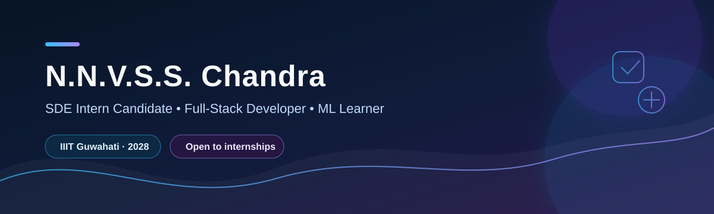

  

   

  
  
  
  

 

> **Building practical software, learning from every project, and preparing for SDE internships.**

## ✦ Profile

<table>
  <tr>
    <td width="50%" valign="top">
      <b>Education</b> 
      B.Tech. CSE, <b>IIIT Guwahati</b> 
      Class of 2028 · CGPA 8.42
    </td>
    <td width="50%" valign="top">
      <b>Opportunity</b> 
      SDE internships across India 
      Remote roles internationally
    </td>
  </tr>
</table>

I am a full-stack developer with an interest in backend systems and real-time applications. I am also building a foundation in machine learning through hands-on work with Python, NumPy, Pandas, and scikit-learn.

## ◈ Technology Toolkit

  
  
  
  
  

  
  
  
  
  
  

  
  
  
  

  
  
  
  
  

  
  
  
  
  
  

\n\n## ⬡ Selected Work

<table>
  <tr>
    <td width="50%" valign="top">
      <h3>⚡ <a href="https://github.com/chandunimmakayala9390-blip/pulseboard">Pulseboard</a></h3>
      
Real-time analytics dashboard built with <b>FastAPI, WebSockets, SQLite, and SQLAlchemy</b>.

      <ul>
        <li>Ingests events through a REST API and persists them with SQLAlchemy.</li>
        <li>Broadcasts live updates to counters, event feeds, and charts without page refreshes.</li>
      </ul>
    </td>
    <td width="50%" valign="top">
      <h3>🚀 <a href="https://github.com/chandunimmakayala9390-blip/Lunar-Lander-project">Lunar Lander Agent</a></h3>
      
AI Lab group project using evolutionary optimization for <b>LunarLander-v3</b>.

      <ul>
        <li>Led implementation of a genetic algorithm with SBX crossover and polynomial mutation.</li>
        <li>Built training, evaluation, policy-saving, and human-play workflows.</li>
      </ul>
    </td>
  </tr>
  <tr>
    <td width="50%" valign="top">
      <h3>👾 <a href="https://github.com/chandunimmakayala9390-blip/Alien-Invasion-Game">Alien Invasion</a></h3>
      
A Python/Pygame arcade shooter designed with modular, object-oriented components.

      <ul>
        <li>Implemented collision detection, scoring, levels, lives, and dynamic difficulty.</li>
        <li>Applied event-driven programming and game-state management.</li>
      </ul>
    </td>
    <td width="50%" valign="top">
      <h3>🎯 Looking for next</h3>
      
Opportunities to contribute to reliable software systems, learn from strong engineering teams, and grow as an SDE.

      
<a href="mailto:chandunimmakayala9390@gmail.com">Let’s connect →</a>

    </td>
  </tr>
</table>

## ◌ Problem-Solving Journey

<table>
  <tr>
    <td align="center" width="33%"><b>600+</b> DSA problems across platforms</td>
    <td align="center" width="33%"><b>1658</b> Peak LeetCode rating</td>
    <td align="center" width="33%"><b>1591</b> CodeChef DSA rating</td>
  </tr>
</table>

  <a href="https://leetcode.com/u/ch_andu1639/">LeetCode</a> &nbsp;·&nbsp;
  <a href="https://codolio.com/profile/chandu1639">Codolio</a> &nbsp;·&nbsp;
  <a href="https://takeuforward.org/profile/chandu1639">takeUforward</a>

## ↗ Current Direction

- Strengthening DSA and interview problem-solving skills
- Building backend and real-time full-stack projects
- Learning practical machine-learning workflows

  Thanks for visiting. I’m open to SDE internship opportunities and technical conversations.

