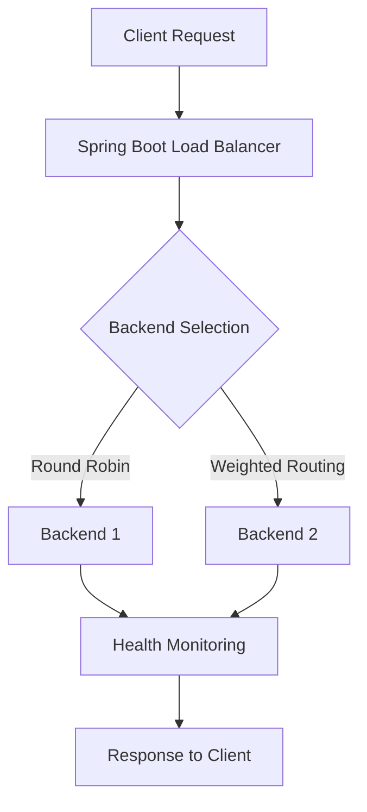
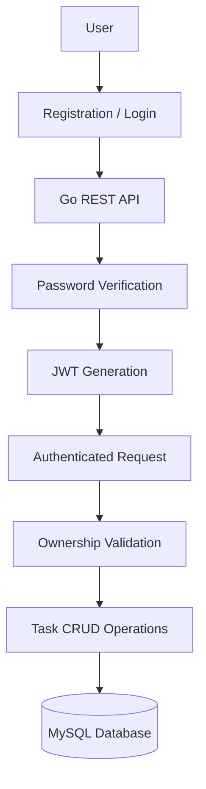
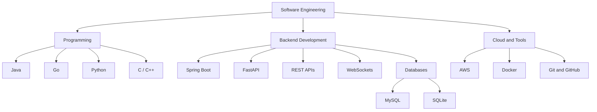

 

# CHANDRA NIMMAKAYALA

**Computer Science Undergraduate | Backend Engineering | Problem Solving**

B.Tech CSE · IIIT Guwahati · 2024–2028 · CGPA 8.40

[LinkedIn](https://www.linkedin.com/in/naga-venkata-shanmukha-sai-chandra-nimmakayala-0a023431a/) · [Email](mailto:chandunimmakayala9390@gmail.com) · [GitHub](https://github.com/chandunimmakayala9390-blip) · [LeetCode](https://leetcode.com/u/ch_andu1639/)

---

## About Me

I'm a Computer Science undergraduate at IIIT Guwahati interested in backend engineering, API development, databases, and building reliable software systems.

I enjoy turning ideas into practical applications, measuring their performance, and continuously improving my engineering skills.

Currently looking for **SDE and Backend Engineering internship opportunities**.

## Featured Projects

### 1. FlowForge — Concurrent HTTP Load Balancer

[Source Code](https://github.com/chandunimmakayala9390-blip/flowforge)

A Java and Spring Boot load balancer supporting multiple backend servers.

**Engineering highlights**
- Round-robin and weighted request routing.
- Concurrent backend health monitoring.
- Configurable timeouts and automatic failover.
- 6/6 concurrent unit tests passing.

**Performance benchmark**

| Metric | Result |
|---|---:|
| Throughput | 5,981 requests/sec |
| p95 latency | 2.53 ms |
| Reported request failures | 0% |
| Load test | 10 virtual users, 30 seconds |

**Request routing architecture**

Technologies: Java, Spring Boot, Maven, k6.

### 2. TaskFlow — Go REST API

[Source Code](https://github.com/chandunimmakayala9390-blip/Task-Flow)

A secure task management backend with authentication and persistent storage.

- Implemented 8 REST API endpoints.
- JWT authentication and bcrypt password hashing.
- Ownership validation for user-specific tasks.
- MySQL integration using parameterized queries.
- Connection pooling and relational constraints.

**Authentication workflow**

Technologies: Go, MySQL, JWT, REST APIs.

### 3. PulseBoard — Real-Time Analytics

[Source Code](https://github.com/chandunimmakayala9390-blip/pulseboard)

A real-time event analytics dashboard.

- REST APIs for event ingestion and persistent storage.
- WebSocket-based live dashboard updates.
- Event aggregation by type and minute.
- Live counters, event feeds and events-per-minute charts.

Technologies: Python, FastAPI, SQLite, SQLAlchemy, WebSockets.

### 4. Real Estate DBMS

[Source Code](https://github.com/chandunimmakayala9390-blip/Real_Estate_Dbms)

A database-backed property and deal management application.

- Developed Java modules supporting two user roles.
- MySQL integration through JDBC.
- Five core database tables.
- Three automated report categories: sales, rentals and agent performance.

Technologies: Java, MySQL, JDBC.

---

## Technology Stack

| Category | Technologies |
|---|---|
| Programming Languages | C, C++, Java, Go, Python, SQL, JavaScript |
| Backend | Spring Boot, FastAPI |
| Libraries | SQLAlchemy, JDBC, WebSockets, JWT, bcrypt, boto3 |
| Databases | MySQL, SQLite |
| Cloud | AWS EC2, S3, RDS, Elastic Beanstalk |
| Tools | Git, GitHub, Docker, Maven, AWS CLI, VS Code |

## Technology Relationship Graph

---

## Problem Solving

| Achievement | Result |
|---|---:|
| DSA Problems Solved | **800+** |
| Peak LeetCode Rating | **1669** |
| LeetCode Ranking | **Top 17%** |
| CodeChef Rating | **1591** |
| CodeChef Global Rank | **4669** |

[LeetCode Profile](https://leetcode.com/u/ch_andu1639/) · [Codolio](https://codolio.com/profile/chandu1639) · [TakeUForward](https://takeuforward.org/profile/chandu1639)

### My GitHub Activity

My actual contribution history, including commits, repositories and activity, is available on my GitHub profile.

[View GitHub Contributions and Activity](https://github.com/chandunimmakayala9390-blip)

[Explore My Repositories](https://github.com/chandunimmakayala9390-blip?tab=repositories)

---

## Education

**Indian Institute of Information Technology Guwahati**

B.Tech in Computer Science and Engineering

2024–2028 · CGPA: 8.40

**Certifications**
- 100 Days of Code: The Complete Python Pro Bootcamp — Dr. Angela Yu, 57 hours.
- AWS Foundations: Machine Learning Basics — AWS Training & Certification.

**Relevant Coursework**

Data Structures and Algorithms, Object-Oriented Programming, Operating Systems, Database Management Systems, Computer Organization, Cloud Computing, Artificial Intelligence, Linear Algebra, Multivariable Calculus, Optimization Techniques, Probability and Statistics, Discrete Mathematics.

---

## LET'S CONNECT

Interested in backend engineering, software development and building practical systems.

**[Contact Me](mailto:chandunimmakayala9390@gmail.com)**

