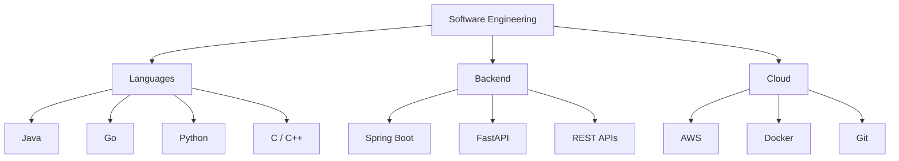

 

# CHANDRA NIMMAKAYALA

**Computer Science Undergraduate | Aspiring Software Engineer**

IIIT Guwahati · B.Tech CSE · 2024–2028 · CGPA 8.40

[LinkedIn](https://www.linkedin.com/in/naga-venkata-shanmukha-sai-chandra-nimmakayala-0a023431a/) · [Email](mailto:chandunimmakayala9390@gmail.com) · [LeetCode](https://leetcode.com/u/ch_andu1639/) · [Codolio](https://codolio.com/profile/chandu1639)

---

## About Me

Hey! I'm a Computer Science undergraduate at IIIT Guwahati passionate about software engineering, backend development, problem solving and building practical applications.

- Currently strengthening my backend engineering skills.
- Interested in scalable systems, databases and cloud technologies.
- Practising DSA and preparing for software engineering internships.
- Always curious about learning new technologies.

## Tech Stack

**Languages**

`C` `C++` `Java` `Go` `Python` `SQL` `JavaScript`

**Backend & Libraries**

`Spring Boot` `FastAPI` `SQLAlchemy` `JDBC` `WebSockets` `JWT` `bcrypt` `boto3`

**Databases**

`MySQL` `SQLite`

**Cloud & Tools**

`AWS EC2` `AWS S3` `AWS RDS` `Elastic Beanstalk` `Docker` `Git` `GitHub` `Maven` `AWS CLI`

## Technology Map

## Competitive Programming

| Achievement | Statistics |
|:---|:---:|
| DSA Problems Solved | **800+** |
| LeetCode Peak Rating | **1669** |
| LeetCode Ranking | **Top 17%** |
| CodeChef Rating | **1591** |
| CodeChef Global Rank | **4669** |

[LeetCode](https://leetcode.com/u/ch_andu1639/) · [CodeChef](https://www.codechef.com/) · [Codolio](https://codolio.com/profile/chandu1639) · [TakeUForward](https://takeuforward.org/profile/chandu1639)

## Education

**Indian Institute of Information Technology Guwahati**

B.Tech in Computer Science and Engineering · 2024–2028

CGPA: **8.40**

## Certifications

- 100 Days of Code: The Complete Python Pro Bootcamp — Dr. Angela Yu (57 hours).
- AWS Foundations: Machine Learning Basics — AWS Training & Certification.

## GitHub

**Explore my work and contribution history**

[Repositories](https://github.com/chandunimmakayala9390-blip?tab=repositories) · [Contribution Activity](https://github.com/chandunimmakayala9390-blip)

---

**BUILD · LEARN · IMPROVE**

Open to SDE internship opportunities and engineering collaborations.

[Let's Connect](mailto:chandunimmakayala9390@gmail.com)

